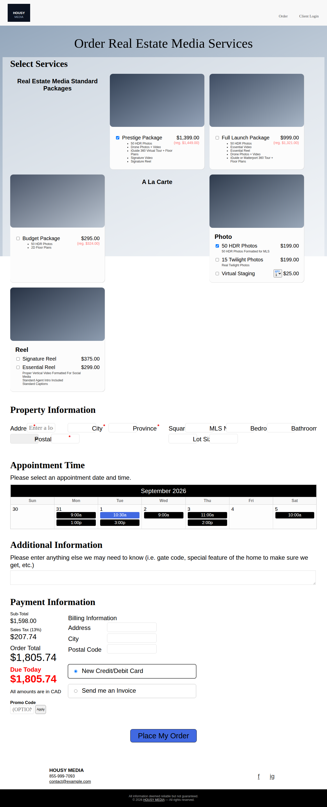
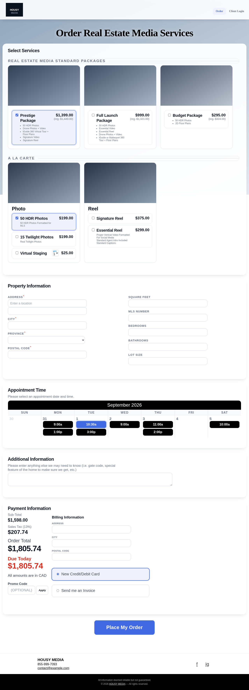

# Housy Media — Order Page CSS Makeover

A custom-CSS makeover for the HDPhotoHub (hd.pics) order page at
**https://housymedia.hd.pics/order**.

HDPhotoHub lets site owners inject custom CSS into the shopping cart, so
this repo ships a single stylesheet you paste into your dashboard — no code
changes on the platform side.

| Before (stock) | After (makeover) |
|---|---|
|  |  |

*Screenshots are from `preview/hdpics-order.html`, a structural mock built
from the live page's own markup and generated CSS (no personal data, no
tracking, no API keys).*

## What the makeover does

**Section panels** — each cart module (`.cart-products`, `.cart-location`,
`.cart-gcal`, `.cart-note`, `.cart-payment`) becomes a rounded, lightly
blurred white card floating over the hero photo. Steps the customer hasn't
reached yet stay quiet instead of showing an empty card.

**Service picker** — the part that decides whether an order gets placed:
- Divider categories ("A La Carte", "Real Estate Media Standard Packages")
  span the full row as real section headings instead of sitting in a narrow
  370px box beside the product cards.
- Product cards get hairline borders, soft shadows, edge-to-edge fluid
  thumbnails and a hover lift.
- Every product row is a selectable card — hover tint, and a brand ring plus
  tinted fill when its checkbox is checked (`:has()`), so what's selected is
  unmistakable.
- Prices are tabular-figure aligned; the "reg." price is struck through and
  muted instead of pink.

**Forms** — the stock layout squeezes captions and fields into 65px/95px
columns. Labels now sit above full-width fields as uppercase micro-labels,
empty spacer captions collapse, and inputs get a proper border, focus ring
and 16px sizing on mobile.

**Calendar, payment, CTA** — rounded time slots with hover feedback, payment
options as selectable cards, and a Place My Order button in brand blue with
white text (the stock config renders black text on royal blue), a hover lift,
and a disabled state that reads as "not yet" rather than broken.

**Plus** — mobile pass (46px targets, no iOS zoom, full-width CTA, no fixed
background), `prefers-reduced-motion`, and a print stylesheet.

## Install

1. HDPhotoHub dashboard → site/cart settings → custom CSS.
2. Paste the full contents of [`css/order-makeover.css`](css/order-makeover.css).
3. Save and hard-reload `https://housymedia.hd.pics/order`.

## Re-branding

```css
:root {
  --hm-brand: #4169E1;  /* change this one line to re-brand the page */
}
```

It defaults to `#4169E1` — the accent the cart already uses for selected time
slots and the order button — so it matches out of the box. Hovers, rings,
tints, badges and selected states are all mixed from it with `color-mix()`,
with static fallbacks for older browsers.

## What this stylesheet deliberately does not touch

The cart's JavaScript reveals each step by animating inline `height` and
`opacity` on `.wrapper` / `.content`, and shows or hides products with
`display` on `label.product` (`.filtered`, `.pkghide`, `.outofarea`).

So this file **never** sets `height`, `opacity`, or `display` on those
elements — product row styling is applied to the inner `<table>`, not the
label. Keep that rule if you extend it, or ordering breaks.

## Local preview

Open `preview/hdpics-order.html`. Comment out the `order-makeover.css`
`<link>` near the top to compare against the stock look.
