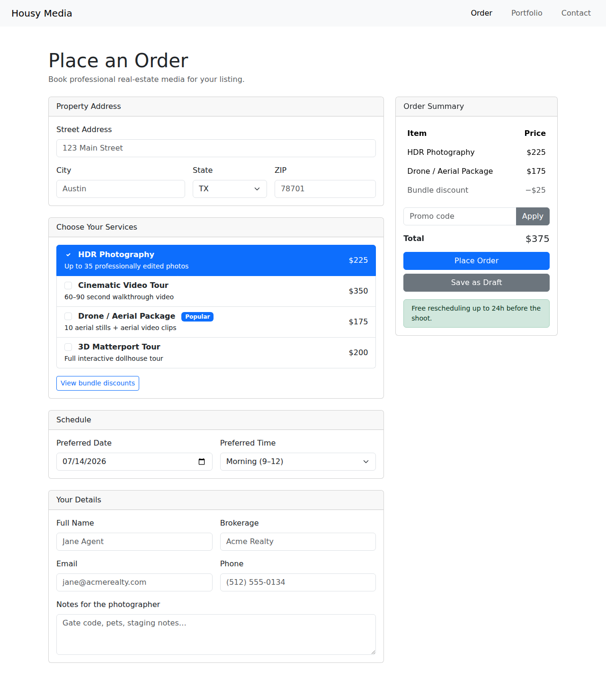
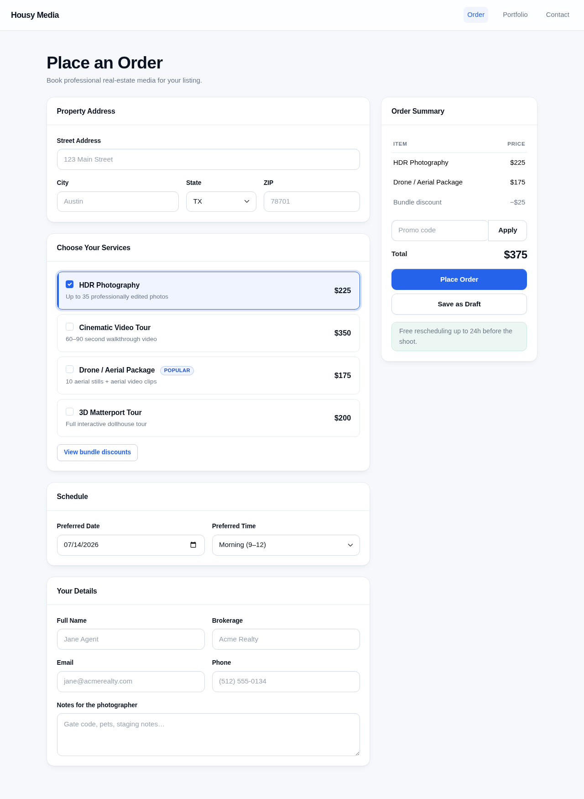

# Housy Media — Order Page CSS Makeover

A custom-CSS makeover for the HDPhotoHub (hd.pics) order page at
**https://housymedia.hd.pics/order**.

HDPhotoHub lets site owners inject custom CSS into the shopping cart /
order form, so this repo ships a single stylesheet you paste into your
dashboard — no code changes on the platform side.

| Before (stock) | After (makeover) |
|---|---|
|  |  |

*Screenshots are from `preview/index.html`, a mock of a typical hd.pics
order form built on stock Bootstrap.*

## What the makeover does

**Foundation**
- **Typography** — Inter, a real type scale, tight tracking on headings, and
  tabular numerals so every price and total lines up in a column.
- **Color system** — set `--hm-brand` and the whole page re-tints. Hovers,
  focus rings, badges, selected states and soft backgrounds are all derived
  from it with `color-mix()` (with static fallbacks for older browsers).
- **Depth** — layered low-alpha shadows and hairline borders instead of the
  stock hard 1px boxes. Static panels don't animate; only things you can
  actually click do.

**The parts that decide whether an order gets placed**
- **Service picker** — each option is a proper selectable card: hover lift,
  brand ring, tinted background and a left accent bar on the selected one,
  price right-aligned and weighted.
- **Order summary** — sticky on desktop so the total stays visible while the
  customer works down the form; uppercase micro-headers, and the total set
  at display size.
- **Buttons** — solid brand primary with an inset highlight and a lift on
  hover, quiet white secondary, press feedback, visible focus rings.
- **Forms** — 1px borders with a soft inner shadow, brand focus ring,
  branded checkboxes/radios via `accent-color`, flush input groups.

**Polish**
- **Mobile** — 46px tap targets, 16px inputs (stops iOS zooming on focus),
  full-width primary actions, summary unsticks and stacks.
- **Chrome** — translucent blurred navbar, softened modals and dropdowns,
  thin scrollbar, brand text selection, tinted alerts and pill badges.
- **Accessibility** — one consistent `:focus-visible` ring everywhere, and a
  `prefers-reduced-motion` block that kills every transition and transform.
- **Print** — the order prints cleanly: no navbar, no buttons, no shadows.

Everything is CSS against the markup HDPhotoHub already renders — no added
elements, no changed behaviour.

## Install

1. Open your HDPhotoHub dashboard → **Settings → Shopping Cart** (design /
   custom CSS section).
2. Paste the full contents of [`css/order-makeover.css`](css/order-makeover.css)
   into the custom CSS field. If your dashboard only offers a custom
   `<head>` HTML field, wrap the CSS in `<style> … </style>`.
3. Save and reload `https://housymedia.hd.pics/order`.

## Re-branding

All design decisions live at the top of the stylesheet:

```css
:root {
  --hm-brand:   #2563eb;  /* change this one line to re-brand the page */
  --hm-ink:     #0b1220;  /* headings                                  */
  --hm-page-bg: #f6f8fc;  /* page background                           */
  --hm-radius:  16px;     /* card rounding                             */
  ...
}
```

`--hm-brand` is the only value you normally need to touch — buttons, links,
focus rings, selected services, badges, alerts and the page's top glow are
all mixed from it. Radius, shadow, motion and the neutral ramp are separate
variables in the same block if you want to go further.

## Local preview

Open `preview/index.html` in a browser. It is a stand-alone mock of the
order form (stock Bootstrap 5 + the makeover). Comment out the
`order-makeover.css` `<link>` in that file to compare against the stock
look.

## Notes / limitations

This stylesheet targets standard Bootstrap classes (`.card`, `.btn`,
`.form-control`, `.list-group-item`, `.table`, …), which is what the
hd.pics cart is built on. If a specific element on the live page doesn't
pick up a style, grab its exact class/ID from the browser dev tools and
add a matching rule — the variables make one-off overrides trivial.
